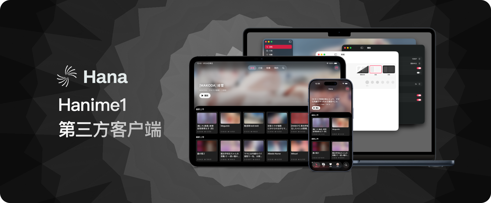

# Hana

Hana is a SwiftUI media client for iPhone, iPad, Mac, and folding iPhone layouts.

## Features

- Discover, search, tags, brands, duration filters, favorites, and playlists
- Multiple site profiles with separate login state and credentials
- Built-in hanime1.me Cookie Sync and account login
- Custom sources, H@H / E-Hentai / ExHentai support, source lookup, and profile-aware search
- Continue Watching, watch history, resume positions, recommendations, and smart playlists
- AVKit playback with Picture-in-Picture, background audio, lock-screen controls, 10-second seek, chapter controls, and playback speed
- Downloads, download queues, storage controls, pause/resume, and watched-download cleanup
- Private mode, thumbnail/title blur, biometric app lock, and Keychain-protected credentials
- iPhone, iPad, Split View, Slide Over, folding-screen adaptive layouts, and macOS support
- iCloud-backed local data for supported watch, favorite, playlist, source, and settings state

## Build Requirements

- Xcode 26.6 or a compatible macOS-26 Xcode toolchain
- iOS 26 SDK
- macOS 26 SDK

## Run

1. Open `Hana.xcodeproj`.
2. Select the `Hana` scheme.
3. Choose an iPhone, iPad, simulator, or Mac target.
4. Build and run.

Command-line examples:

```bash
xcodebuild -project Hana.xcodeproj -scheme Hana -destination 'generic/platform=iOS Simulator' build
xcodebuild -project Hana.xcodeproj -scheme Hana -destination 'platform=macOS' build
```

## Download

Unsigned iOS builds are published through GitHub Releases. Install only on devices where you trust the source and understand that unsigned IPA files require a compatible sideloading workflow.

## Source Profiles

The Profile tab manages independent site profiles. The built-in hanime1.me profile retains the existing Cookie Sync and Account Login flow. Additional profiles can use Cookie Sync, account credentials, or API tokens. Secret values are stored in the Keychain, not in UserDefaults or logs.

## Development

- The existing Hanime HTML parser and search-option catalog remain the built-in hanime1.me implementation.
- Do not commit credentials, cookies, API keys, H@H host details, or login tokens.
- Keep local build output such as `build/`, `DerivedData/`, and user-specific Xcode state out of source control.
- Verify iOS and macOS behavior after cross-platform changes.

## License

Hana is licensed under the GNU Affero General Public License v3.0 or later. See [LICENSE](LICENSE).

Copyright 2026-present Kanscape and contributors.

Search resources and HKeyframes resources originate in part from Han1meViewer and retain their Apache License 2.0 copyright and license text. Third-party dependencies and resource sources are listed in [NOTICE](NOTICE) and [LICENSES](LICENSES).

## Disclaimer

Hana is a client implementation. Users must follow the terms of each target site, applicable law, and content-access restrictions.
